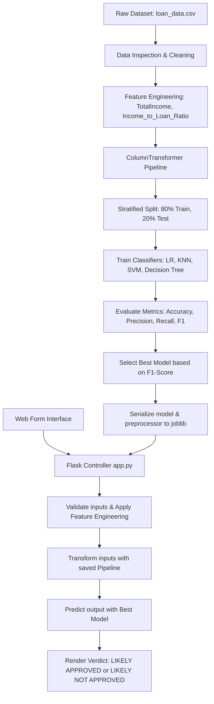

# AI-Based Loan Approval Prediction & Decision Support System
## Project Documentation & Technical Report

---

## 1. Project Overview & Background
This project was developed as a final implementation of a 15-Day B.Tech Artificial Intelligence and Data Science internship. It targets the automation of credit underwriting decisions by employing classification algorithms. Using historical data, we train, validate, and compare four supervised learning models: **Logistic Regression**, **K-Nearest Neighbors (KNN)**, **Support Vector Machines (SVM)**, and **Decision Tree Classifiers**. The top-performing model (based on the F1-Score) is exported alongside its preprocessing pipelines to serve real-time predictions via a Flask-based web interface.

---

## 2. Internship Curriculum Alignment
The implementation directly integrates concepts taught throughout the 15-Day curriculum:
* **Day 2 (Python Programming)**: Modularity, functions, class styling, and serialization.
* **Day 3 (NumPy & Pandas)**: Data wrangling, type transformations, vector maths, and handling missing data.
* **Day 4 (Matplotlib & Seaborn)**: Categorical count plots, distributions, heatmaps, and subplots.
* **Day 5 & 6 (ML Workflow & Preprocessing)**: Splitting datasets, feature scaling, column transformation, and avoiding data leakage.
* **Day 8 (KNN & Classification)**: Setting K-parameters and utilizing distance metric calculations.
* **Day 9 (SVM & Decision Trees)**: Evaluating kernel functions and entropy/Gini index nodes.
* **Day 14 & 15 (Project Development & Conclusion)**: Integrating trained classifiers into Flask backends and structuring result dashboards.

*Note: While NLP (Day 10), Computer Vision/OpenCV (Day 11-12), and Generative AI (Day 13) were key learning topics in the curriculum, they are not artificially declared as components of this binary classification model.*

---

## 3. System Analysis
### Existing System
Traditional loan underwriting relies on manual verification of assets, liabilities, salary transcripts, and credit score records.
* **Drawbacks**: 
  - Slow turnaround times (days/weeks).
  - High operational costs.
  - Inconsistency due to subjective evaluations.

### Proposed System
A machine learning decision support system that automates the initial screening of applicants.
* **Advantages**:
  - Near-instantaneous decision support.
  - Standardized evaluation criteria.
  - Interactive dashboard containing model analytics and training charts.
  - Dynamic model selection based on actual performance.

---

## 4. System Architecture & Workflow

The architecture is split into three main phases: Data Pipeline, Model Selection, and Live Serving.

---

## 5. Dataset & Feature Engineering
The model uses the benchmark Kaggle/Analytics Vidhya Loan Prediction dataset (614 rows, 13 features).

### Feature Dictionary

| Feature Name | Type | Description |
|---|---|---|
| `Loan_ID` | Categorical | Unique alphanumeric identifier (dropped during preprocessing) |
| `Gender` | Categorical | Male or Female |
| `Married` | Categorical | Marital status (Yes or No) |
| `Dependents` | Categorical | Number of financial dependents (0, 1, 2, 3+) |
| `Education` | Categorical | Academic qualification (Graduate or Not Graduate) |
| `Self_Employed` | Categorical | Self-employment indicator (Yes or No) |
| `ApplicantIncome` | Numeric | Monthly income of the primary applicant ($) |
| `CoapplicantIncome` | Numeric | Monthly income of the coapplicant ($) |
| `LoanAmount` | Numeric | Requested loan amount (expressed in thousands, $) |
| `Loan_Amount_Term` | Numeric | Loan amortization duration (expressed in months) |
| `Credit_History` | Categorical | Credit score eligibility flag (1.0 = meets guidelines, 0.0 = does not meet) |
| `Property_Area` | Categorical | Property location (Urban, Semiurban, Rural) |
| `Loan_Status` | Categorical | Target label (Y = Approved, N = Rejected) |

### Engineered Features
1. **`TotalIncome`** (ApplicantIncome + CoapplicantIncome): Combining incomes evaluates the aggregate repayment pool.
2. **`Income_to_Loan_Ratio`** (TotalIncome / (LoanAmount + 0.001)): Normalizes aggregate income against borrowed principal. Adding 0.001 protects against division-by-zero errors.

---

## 6. Preprocessing & Anti-Leakage Pipeline
To avoid data leakage, preprocessing parameters (median values, modes, standard deviation, and mean) are computed on the training set only and then applied to the test set.

* **Numerical Preprocessing**:
  - Imputation: `SimpleImputer` replaces missing values with the **median**.
  - Scaling: `StandardScaler` standardizes numeric inputs to mean = 0 and variance = 1.
* **Categorical Preprocessing**:
  - Imputation: `SimpleImputer` replaces missing strings with the **most frequent** category (mode).
  - Encoding: `OneHotEncoder(drop='first')` converts string values to numerical binaries, removing multicollinearity.

---

## 7. Model Performance Comparison
The classifiers were trained with `random_state=42` and `stratify=y`.

| Model Name | Accuracy | Precision | Recall | F1-Score |
|---|---|---|---|---|
| **Logistic Regression** | **86.18%** | **84.00%** | **98.82%** | **90.81%** |
| Support Vector Machine (SVM) | 84.55% | 82.35% | 98.82% | 89.84% |
| Decision Tree Classifier | 84.55% | 84.38% | 95.29% | 89.50% |
| K-Nearest Neighbors (KNN) | 79.67% | 79.41% | 95.29% | 86.63% |

* **Analysis**:
  - **Credit History** is the single most critical factor; applicants without credit history (0.0) are highly likely to be rejected.
  - **Logistic Regression** achieved the highest F1-Score (90.81%) and was chosen as the active production model.

---

## 8. Web Server & Endpoint Architecture
The Flask application (`app.py`) defines a structured, RESTful routing interface:
* `GET /`: Serves the primary executive dashboard displaying key dataset metrics, the multi-model leaderboard, feature dynamics, and preview charts.
* `GET /predict`: Serves the standalone loan underwriting application form with live client-side financial calculations (`TotalIncome`, `Income_to_Loan_Ratio`) and quick-fill demo buttons.
* `POST /predict`: Receives applicant parameters, enforces strict numeric and bounds validation, applies pipeline transformations, predicts outcomes via the serialized `best_model.pkl`, and renders the decision report with confidence scoring and PDF print capabilities.
* `GET /analytics`: Serves the comprehensive Exploratory Data Analysis & Model Evaluation gallery with high-resolution Matplotlib figures and academic captions.
* `GET /about`: Provides curriculum alignment documentation, anti-leakage pipeline design, and faculty viva voce defense preparation questions.
* `GET /api/model-info`: REST JSON endpoint delivering live model status, best model name, and performance metrics.
* **Launchers**: One-click automation scripts (`run_app.bat` and `run_app.ps1`) ensure instant local startup and browser launch without encountering static server Jinja rendering bugs.

---

## 9. System Verification & Integration Testing
Comprehensive testing was performed across all routes and input variations (documented in detail in `UI_TESTING.md`):
* **Positive Credit Profile**: Evaluated as `LIKELY APPROVED` with an 81.33% confidence score.
* **Negative Credit Profile**: Evaluated as `LIKELY NOT APPROVED` with a 90.54% confidence score.
* **Input Validation**: Missing fields and negative inputs trigger HTTP 302 redirections with descriptive flash warnings.
* **Error Handling**: Non-existent URLs return custom HTTP 404 views without exposing raw stack traces.

---

## 10. Ethics, Limitations, and Future Scope
* **Educational Disclaimer**: This application is a decision support demonstration. Actual loan sanctioning involves credit bureau reporting, legal checks, KYC verification, and bank policy checks.
* **Limitations**: Operates on a relatively small static dataset (614 rows). It does not account for interest rate fluctuations or macro-economic parameters.
* **Future Work**: Implementing automated document verification using OCR (e.g. bank statements), and integrating SHAP explainability to display visual breakdown charts to loan officers.

